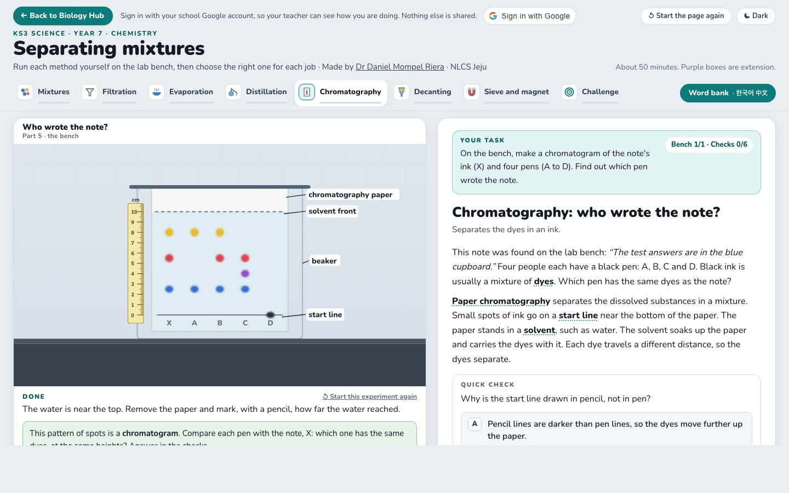

# Separating mixtures · KS3 Year 7

**Live:** <https://nlcsbiology.com/ks3-separating-mixtures-pract/>

A practical lesson for Year 7 (KS3 Chemistry). Instead of a teacher showing each separation method one by one,
pupils **run every method themselves on a virtual lab bench**, and answer a quick check after each piece of theory.
It complements the real practical, where pupils plan and carry out their own separation; that mixture is never
simulated here.

| Part | On the bench | The idea |
|---|---|---|
| 1 Mixtures | zoom in on eight samples (gold, distilled and mineral water, salt, coffee, brass, muddy water, air); dissolve salt and watch water particles close round each ion until it is saturated, then try sand. Extension: milk, a colloid, with a torch beam | pure substance or mixture; one phase or more; particles in a solid, a liquid and a gas; solute, solvent, soluble, insoluble, saturated |
| 2 Filtration | fold the paper, filter muddy water, look at the paper close up, then filter salt water and test a drop | residue and filtrate; size and solubility |
| 3 Evaporation and crystallisation | evaporate salt solution; grow copper sulfate crystals, testing with a glass rod | volatility; saturation; solubility falls as it cools |
| 4 Distillation | connect the condenser, distil seawater, read the thermometer, test the distillate. Extension: fractional distillation with a live temperature graph | condensing; the distillate; boiling point |
| 5 Chromatography | "Who wrote the note?": a chromatogram of five black inks, with a real-life view of smeared dyes beside a photo. Extension: an Rf value worked out on the bench | start line, solvent, stationary and mobile phase, affinity |
| 6 Decanting and the separating funnel | tip a beaker of settled sand; run off the lower layer of oil and water | density; immiscible liquids |
| 7 Sieve and magnet | a recycling plant's electromagnet over steel and aluminium cans; a garden sieve | magnetism; size |
| 8 Method challenge | ten real jobs: choose the method, or the methods in order; then the recap table | choosing a method |

**Pupils learn from mistakes they choose.** Each bench offers the classic error beside the right step: a pen start
line that runs, water above the start line, cold water into the top of the condenser, a funnel filled over the
paper, a beaker tipped too far, the separating funnel's tap opened with the stopper in. The bench shows what goes
wrong, then lets them try again.

**Particles as pupils draw them.** Solids are a lattice; liquid water is particles that touch and slide past each
other, held close by hydrogen bonds; a gas is particles far apart, moving fast. When salt dissolves, water particles
close round each ion (oxygen towards sodium, a hydrogen towards chloride) and carry it away; sand is one giant structure
that the water cannot pull apart. When a pupil scrolls to a question about an animation, the bench shows that animation,
and the question says where to look ("👀 On the bench · …"). Every word a question uses is explained, as a word to tap,
in the text above it.

**Real photos.** A 📷 Real photo switch above each bench shows the real apparatus. On Zoom in, **👁 Show what you see** turns
the lens on the sample pressed from its particles to a close-up of the material itself, as your eyes see it (real photos;
water, muddy water and air drawn), with ＋ and − to look closer, so pupils sort mixtures by phases at the visible level, not by
their particles.

**Made for Year 7.** Big text on the page and on the bench. A choice on the bench is asked in a yellow bubble beside its
buttons, every instruction is highlighted, and the next bench to do lights up when one is finished.

**About 50 minutes.** Purple boxes are extension. Key words are typed (spelling counts; capitals do not), with one
word bank for the page in **English, Korean and Chinese**. Methods, apparatus and the order of steps are chosen,
sorted or put in order. The answers are shown only after two tries.

**For the teacher.** A pupil who signs in with their school Google account has every check and every finished bench
saved for their teacher, who sees it live on the teacher page's 🔬 Practicals board: right first time, the number
of checks, and the wrong answers given. Signed out, the page works the same and nothing leaves the computer. Answers
survive a reload.

**Made by** Dr Daniel Mompel Riera, NLCS Jeju. Something wrong, or a suggestion? dmompelriera@nlcsjeju.kr

**Licence.** Code: AGPL-3.0 (`LICENSE`). Teaching material: CC BY-NC-SA 4.0 (`LICENSE-CONTENT`): free for
teaching, not for selling. Every drawing on the bench was drawn for this page. The real photos come from Wikimedia
Commons and are credited under each photo and in the page footer (`img/photos/CREDITS.json`): CC BY, CC0 or public
domain, except the filtration photo (David Rouzek, CC BY-SA 4.0).

Behind the scenes

- `index.html` holds the words of each part; `js/questions.js` every check (its id is its square on the teacher's
  board: keep the id when rewording); `js/words.js` the word bank with Korean and Chinese.
- `js/bench.js` runs a bench (steps, buttons on the apparatus, mistakes, press-and-hold) and switches to the scene a
  question names (`data-scene` on its slot in `index.html`); `js/kit.js` draws the glassware and every lens of liquid
  water (`liquidLens`); `js/sims/*.js` are the eight benches; `js/photos.js` the real photos; `js/checks.js` draws and
  marks the checks.
- `js/signin.js` and `js/lesson.js` are copies of the Biology Hub's shared files (`labs-shared/`), made by
  `node tools/practicals-sync.mjs` in the workspace: never edit them here.
- After changing a check: `node tools/make-questions.mjs` (writes `data/questions.json`, which the teacher's board
  reads), then `node tools/stamp.mjs` (one version for `version.txt` and every `?v=`).
- `?still=1` jumps every animation to its end (tests); `?demo=5` clicks through a bench for a screenshot.
- `node tools/overlap-audit.mjs` runs every bench, every step and every mistake at seven window sizes and reports
  buttons or words that overlap or are cut off; `--gallery <part> out.png` draws every step for a person to look at;
  `--scroll` checks that scrolling to a question or an extension brings up its scene.

